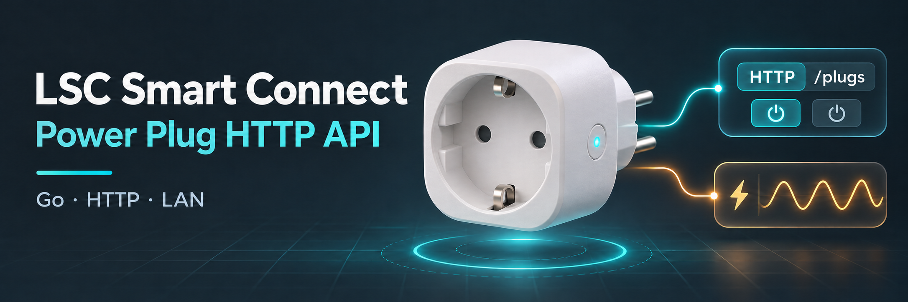

# Plug API



A small Go HTTP service for direct access to Tuya LAN 3.5 smart plugs and LED strips.
It supports the LSC 3202087.2 plug (`lsc-3202087-2`) and LSC Smart Neon Striplight
(`lsc-neon-strip`). Other protocols and profiles are rejected at startup.

## Behavior

- One JSON configuration file includes device settings and Local Keys.
- `GET /plugs` and `GET /lights` return configured IDs without contacting any device.
- Every device read opens a LAN session and sends STATUS. There is no state
  cache, database, background polling, heartbeat, or cloud dependency.
- Each operation closes its session. This keeps acknowledgements from one
  HTTP request out of the next request's connection.
- Requests for one device run sequentially. Different devices work independently.
  One active request and eight waiting requests are allowed per device.
- The request timeout includes queueing, connection setup, and device exchange.
- Writes use preflight STATUS and one CONTROL_NEW per set of global values or
  group of segments with the same color and brightness. The API verifies global
  values with STATUS and reads once more for lights if the first response has yet
  to reflect the change. The API never resends CONTROL_NEW automatically.
- Logs are written as text to stdout for collection by systemd. Optional OpenTelemetry Logs
  export uses OTLP/HTTP protobuf and a bounded background queue.
- Swagger UI and the OpenAPI specification are embedded in the executable.
  No CDN or internet connection is needed to use the documentation.

## Build and run

Go 1.26 or newer is required by the pinned dependencies.

```sh
go build -o bin/plug-api ./cmd/plug-api
cp config.example.json config.json
./bin/plug-api -config config.json -check-config
./bin/plug-api -config config.json
```

The example contains no devices, so it can be started without accessing a plug.
On Windows, use `bin/plug-api.exe` instead.

Open `http://127.0.0.1:8080/docs/` for Swagger UI.
`GET /health` checks only the HTTP service.

## Device manager

The web UI and daily schedule manager live in the separate
[LSC Smart Connect Device Manager](../lsc-smart-connect-device-manager/README.md)
project. Build and run `cmd/plug-web` from that project, and set its `api_url` to
this service (default `http://127.0.0.1:8080`). The manager keeps browser accounts,
API credentials, and schedule state separately; this service retains device
configuration, Local Keys, and all device communication.

## Configuration

Add smart plugs to the `plugs` array. The address below is a documentation placeholder; replace it with the device address:

```json
{
  "id": "desk-plug",
  "name": "Desk plug",
  "address": "192.0.2.10",
  "device_id": "YOUR_DEVICE_ID",
  "local_key": "YOUR_16_BYTE_KEY",
  "protocol": "3.5",
  "profile": "lsc-3202087-2"
}
```

Add a Neon Striplight to the optional `lights` array using the same fields and
profile `lsc-neon-strip`. Use `"plugs": []` for a light-only setup.
IDs, Device IDs and IP addresses must be unique across both arrays.

Replace the key placeholder with the actual 16-byte Local Key. Addresses must
be unique IP addresses; port 6668 is used. Reserve addresses in DHCP.
IDs must be unique, 1–64 ASCII letters, digits, underscores, or hyphens,
starting with a letter or digit. The API ID is independent of the Tuya Device ID.
Names are for configuration readability and are not returned by the list route.

Configuration is loaded once at startup. Restart the service after editing it.
Unknown configuration fields, unsupported profiles, duplicate devices, and
invalid values are rejected. Errors do not echo secret values.
The timeout defaults to 15 seconds and accepts 1–120 seconds.

The file is a secret: keep it out of version control and restrict its permissions.
On the Pi, use owner `root`, group `plug-api`, mode `0640`.
Provision the Local Key separately without placing it in shell arguments or logs.

### HTTP access

The default listener is `127.0.0.1:8080`. To allow LAN clients, change
`http.listen` to the Pi's LAN address or `0.0.0.0:8080`.
Set `http.token` to a strong token to require `Authorization: Bearer <token>`
on `/plugs` and `/lights` and their subroutes. Swagger UI has an Authorize button. Health and documentation
remain public. A plain HTTP bearer token is visible on the network; use a TLS
reverse proxy when transport protection is needed. The service has no CORS
configuration and Swagger uses the same origin as the API.

### Local logs

The service writes text logs to stdout; startup and logging failures go to stderr.
The systemd unit sends both streams to journald, which manages storage, rotation,
and retention. When running directly in a terminal, logs appear in that terminal.
The application does not create log files.

Remove the old `logging.local` object from existing configuration files; it is no
longer supported and strict configuration validation rejects it.

Log level is `debug`, `info`, `warn`, or `error`. Requests include a generated
`request_id`, returned as `X-Request-ID`, and device operations include `plug_id`.
Headers, bodies, Local Keys, and raw protocol packets are not logged.
Log write failures are reported to stderr.

Read, follow, or export the service logs:

```sh
sudo journalctl -u plug-api --since "1 hour ago"
sudo journalctl -u plug-api -f
sudo journalctl -u plug-api --no-pager > plug-api.log
```

To keep journal logs across reboots, optionally install the supplied drop-in:

```sh
sudo install -d -m 0755 /etc/systemd/journald.conf.d
sudo install -m 0644 deploy/journald.conf.example /etc/systemd/journald.conf.d/60-persistent.conf
sudo systemctl restart systemd-journald
sudo journalctl --flush
```

This is a host-wide setting affecting all journal logs. Persistent journals are
stored under `/var/log/journal/` in journal format; use `journalctl` to read them.
Disk limits and retention follow the host's journald configuration. Without
persistent storage, logs may only be kept in memory and lost on reboot.

### OpenTelemetry Logs

Set `logging.otel.enabled` to `true`, with an origin such as
`http://127.0.0.1:4318` in `endpoint`. The exporter appends `/v1/logs`.
Only OTLP/HTTP protobuf logs are implemented, not tracing or metrics.
`service_name` defaults to `plug-api`.

The exporter buffers up to 1024 events, sends batches up to 128 every two
seconds, and has a five-second export timeout. It does not block device requests
while waiting for the collector. Remote records can be dropped during an outage;
there is no disk-backed remote export queue or replay from local files.
Export errors are logged locally only to avoid a feedback loop.
Shutdown allows six seconds for flushing logs.

`deploy/otel-collector.example.yaml` provides an optional local collector example
that prints received records. Replace its debug exporter with your own backend.

## API

| Method | Path | Action |
| --- | --- | --- |
| GET | `/plugs` | List configured IDs; no network access |
| GET | `/plugs/{id}/state` | Read relay, measurements, and fault mask |
| GET | `/plugs/{id}/settings` | Read supported settings |
| GET | `/plugs/{id}/dps` | Read raw DPS for diagnostics |
| PUT | `/plugs/{id}/relay` | Set and verify relay state |
| PATCH | `/plugs/{id}/settings` | Write and verify selected settings |
| GET | `/lights` | List configured light IDs |
| GET | `/lights/{id}/state` | Read power, mode, stored color and timer |
| PATCH | `/lights/{id}/state` | Set power, color, brightness, timer or segment colors |
| POST | `/lights/{id}/animation` | Start a named animation preset |
| GET | `/lights/{id}/dps` | Read raw DPS for light diagnostics |
| GET | `/health` | Check service health; no network access |
| GET | `/openapi.json` | OpenAPI 3.0.3 specification |
| GET | `/docs/` | Offline Swagger UI |

Read an actual device:

```sh
curl http://127.0.0.1:8080/plugs/desk-plug/state
```

The following command physically switches the connected load:

```sh
curl -X PUT http://127.0.0.1:8080/plugs/desk-plug/relay \
  -H 'Content-Type: application/json' -d '{"on":true}'
```

Change selected settings:

```sh
curl -X PATCH http://127.0.0.1:8080/plugs/desk-plug/settings \
  -H 'Content-Type: application/json' -d '{"indicator_mode":"relay"}'
```

Settings: `countdown_seconds` (0–86400), `power_on_state` (`off`, `on`, `memory`),
`overcharge_protection` (boolean), `indicator_mode` (`relay`, `pos`, `none`, `on`),
and `child_lock` (boolean). Omit unchanged fields; null is rejected on writes.
Only settings present with the expected type in the preflight response can be
written. Countdown can change the relay later. Overcharge protection behavior
has not been validated on this firmware. Cycle, random, and inching timers are
visible only as raw DPS; their encoded write formats are not implemented.

### Neon Striplight

This request turns on the strip and sets its color and brightness.

```http
PATCH /lights/neon_strip/state
Content-Type: application/json

{"on":true,"color":"#FF8000","brightness_percent":30}
```

The API uses hue and saturation from `color` (a `#RRGGBB` value) and sets
brightness independently on a 1–100% integer scale. The returned color is
normalized to full value and can differ slightly from the input due to the
device's HSV precision. Updating only the color preserves brightness. Updating
only brightness preserves the stored hue and saturation. Either update selects
the `colour` mode and sends a power command only if `on` is supplied. Use
`{"on":false}` to turn off the strip. `countdown_seconds` accepts 0–86400
and 0 cancels the timer. A state read can include the last stored color and
brightness while the strip is off or in another mode.

A successful PATCH of global settings returns the verified state with
`"result":"confirmed"`.

### Animations

Use `POST /lights/{id}/animation` with a preset ID. Include `"on":true`
to turn on the strip as part of the same command.

```http
POST /lights/neon_strip/animation
Content-Type: application/json

{"preset":"northern_lights","on":true}
```

If the strip is off and `on` is omitted, the API returns HTTP 409. OpenAPI lists
all 44 preset IDs from the [LSC Neon Striplight profile](https://github.com/make-all/tuya-local/blob/main/custom_components/tuya_local/devices/lsc_neon_ledstrip.yaml#L113-L201).
`northern_lights` and `dream_meteor` were visually verified on the tested strip.

The response echoes the requested `preset` and returns `mode: "scene"` and
`result: "acknowledged"`. The API confirms the mode with STATUS after the
strip acknowledges the scene command. STATUS does not report the active
preset. To return to static light, set `color` with `PATCH /lights/{id}/state`.

### Segment colors

The optional `segments` array in `PATCH /lights/{id}/state` uses its first
position for segment 1. Use `null` to skip a position. This example sets
segments 2 and 3 and skips segment 1.

```http
PATCH /lights/neon_strip/state
Content-Type: application/json

{
  "segments": [
    null,
    {"color":"#FF0000","brightness_percent":30},
    {"color":"#0000FF","brightness_percent":50}
  ]
}
```

Each object requires a nonblack `#RRGGBB` color and an integer brightness
from 1 to 100. The array must contain at least one object and fit within the
configured segment count (36 on the tested strip).

The strip must be on and in `colour` mode when the segment commands run.
Include `"on":true` to turn it on in the same request. Include a whole-strip
`color` or `brightness_percent` to select `colour` mode. The API first applies
and verifies the whole-strip settings, then applies the segment colors.
Omit the whole-strip color and brightness to update just the selected segments.

Requests that include segments return `result: "acknowledged"` once the strip
acknowledges every segment command. The response contains the global state.
The strip's STATUS response does not report segment colors. An off strip or
a mode other than `colour` returns HTTP 409 if the request does not put it in the
required state. An array beyond the configured segment count returns HTTP 422.

### Freshness and errors

`received_at` is server receipt time. STATUS asks for current device state but
does not force a new physical measurement. UPDATEDPS is intentionally not sent
in this version. Missing measurements and settings are returned as null, never
filled from an earlier response or replaced with zero.

`energy_report_wh` is the raw DPS 17 report expressed in Wh. It is not a total
meter; semantics and deduplication still need validation. Runtime, historical
energy, and calculated usage are not exposed.

Verified writes return `result: "confirmed"`. Segment and animation writes
return `result: "acknowledged"`. Here is an example failure response.

```json
{
  "error": {
    "code": "device_timeout",
    "message": "Device operation did not complete successfully",
    "result": "unknown"
  }
}
```

`failed` means no write was attempted. `unknown` means the write may already
have been applied. Read the device before deciding to repeat a write. A PATCH
is not transactional: multiple settings may have been partially applied.

HTTP statuses: 400 invalid input, 401 unauthorized, 404 unknown ID, 408 canceled,
409 light off or in the wrong mode, 413 oversized body, 415 wrong content type, 422 unsupported setting, 502 device
or verification failure, 503 full device queue, and 504 timeout.
The maximum request body is 4096 bytes.

## Raspberry Pi deployment

Build on the Pi with Go 1.26+, or cross-compile from another machine.
For 64-bit Raspberry Pi OS (POSIX shell):

```sh
CGO_ENABLED=0 GOOS=linux GOARCH=arm64 go build -trimpath -o bin/plug-api-linux-arm64 ./cmd/plug-api
```

For 32-bit Raspberry Pi OS on ARMv7-capable hardware, use `GOARCH=arm GOARM=7`.
For older ARMv6 boards, use `GOARCH=arm GOARM=6` and build
`bin/plug-api-linux-armv6`. Choose the target for the OS and CPU; an ARMv7
binary cannot run on an ARMv6 board.

Install the executable and configuration:

```sh
sudo useradd --system --user-group --no-create-home --shell /usr/sbin/nologin plug-api
sudo install -d -o root -g plug-api -m 0750 /etc/plug-api
sudo install -o root -g root -m 0755 bin/plug-api-linux-arm64 /usr/local/bin/plug-api
sudo install -o root -g plug-api -m 0640 config.json /etc/plug-api/config.json
sudo install -m 0644 deploy/plug-api.service /etc/systemd/system/plug-api.service
```

Logs are collected by journald. See Local logs above to enable persistent storage.

```sh
sudo -u plug-api /usr/local/bin/plug-api -config /etc/plug-api/config.json -check-config
sudo systemctl daemon-reload
sudo systemctl enable --now plug-api
sudo systemctl status plug-api
sudo journalctl -u plug-api -f
```

Starting the service does not contact devices. Only device API requests do.

## Code layout

- `cmd/plug-api`: starts the HTTP API for smart plugs and LED strips.
- `internal/config`: strict JSON configuration loading and validation.
- `internal/httpapi`: HTTP handlers, request validation, and embedded docs.
- `internal/device`: per-device queues, LAN operation sequencing, and write verification.
- `internal/smartplug`: smart plug relay, settings, and power measurements.
- `internal/ledstrip`: LED strip state, color encoding, segments, and animations.
- `internal/tuyalan`: TCP framing, AES-GCM, session negotiation, and commands.
- `internal/logging`: stdout logging, slog fan-out, and OTLP export.

There are no generic driver interfaces, repository layers, or worker frameworks.
The implementation uses concrete types and standard-library HTTP and crypto.

## References

- [TinyTuya protocol reference](https://github.com/jasonacox/tinytuya/blob/master/PROTOCOL.md)
- [Compatible DPS profile reference](https://github.com/make-all/tuya-local/blob/main/custom_components/tuya_local/devices/smartplugv2_energyv3.yaml)

Swagger UI 5.34.1 assets are vendored from the official swagger-api/swagger-ui
release. Its Apache-2.0 license and NOTICE are included alongside the assets.
Go dependency versions and checksums are pinned in go.mod and go.sum.
